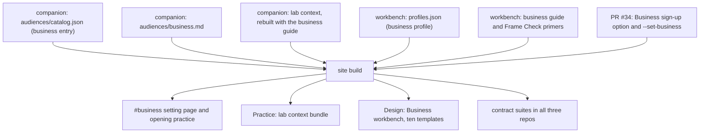

# Business Lens for Judgment Lab - Plan

## Goal Capsule

- **Objective:** A manager or team lead who opens Judgment Lab can choose a business setting, practice the essay's four moves on a business decision (frame the problem, calibrate reliance, refuse the garden path, own the decision), and design that practice for their own team. The PME origin and the three education settings keep working as they do today.
- **Product authority:** Jack decides. He has decided two things: Judgment Lab gets a business lens, and the lens keeps the essay's core issues. Every other choice in this plan is a recommendation waiting on his answer under "Open questions for Jack." A full business essay edition is out of active scope; its argument spine is recorded here for a later plan. PR #34 (the open call) stays out of scope beyond the Business sign-up option and teal color it already carries.
- **Open blockers:** Jack's answers to the six open questions (the first three, on reader, name, and essay shape, decide most of the rest) and his review of the DRAFT guide at `audiences/business.md`.

---

## Product Contract

### Summary

Add Business as a fourth Judgment Lab setting for managers and team leads who review and develop other people's AI-assisted work. The first release gives them a setting page with a short practice, a business guide built on a fictional retention-plan case, a business session in the failure-mode lab, and a Business profile in the Design workbench. Business readers start with the original essay; a full business edition follows once business practitioners have run the case.

### Problem Frame

Judgment Lab describes itself as a lab for educators, and every surface assumes a classroom: settings are PME, higher education, and high school; the workbench speaks of learners, learning objectives, and faculty; the lab's transfer step asks for a teaching objective. The essay's argument does not depend on a classroom. Its second officer directs AI agents toward a purpose she set and defends the result, which is what a manager does when signing a recommendation built from a team's AI-assisted analysis.

Business readers have no way in today. A manager who arrives from the open call (PR #34 adds Business to its settings) finds three education settings and education vocabulary throughout. The repo's strongest evidence for uneven AI reliability already comes from business: Dell'Acqua et al.'s field experiment with consultants.

### Key Decisions

- **Judgment Lab gets a business lens.** Jack's call, October 26, 2026. It is worth a larger addition.
- **The lens keeps the essay's core issues.** Jack's call. Frame capture, calibrated reliance, refusing the garden path, and owning the decision stay the spine. Governs R1, R2, R3, R4.
- **The original essay and `claims.md` stay canonical; business is a translation.** Existing repo rule, the same one HE and high school follow (`essays/adaptation-map.md`, `audiences/shared-foundations.md`). Governs R5, R6.

Every other shape choice is a recommendation in "Open questions for Jack."

### Requirements

**The four moves at work**

- R1. The business case makes frame capture observable: an AI analysis with accurate facts answers a narrower question than the business faces.
- R2. The business practice asks the participant to accept, check, revise, or refuse an AI contribution, and at least one contribution deserves acceptance after a check.
- R3. Business guidance shows a manager refusing the garden path, asking for the standard and the deciding evidence before the recommendation.
- R4. Every business example ends with a changed case that the named decision owner must answer.

**Canon and existing settings**

- R5. The original essay, `claims.md`, and the PME, HE, and high-school settings keep their content, routes, and behavior.
- R6. Business material says it is a design to test, keeps the essay's evidence separate from new proposals, and claims no business result.

**The business reader's path**

- R7. A reader can choose Business wherever the site offers a setting, and the choice persists across Learn, Practice, Design, and essay reading as the other settings do.
- R8. The Business setting page offers the essay, a short opening practice on the business case, and the business guide.
- R9. The failure-mode lab runs a business session that uses the business guide and transfers to a decision the participant's team makes.
- R10. The Design workbench offers a Business profile whose ten templates use the business case.
- R11. Wherever Business is selected, visitor-facing text names workplace roles (team member, manager or reviewer, organization) in place of learner, educator, and institution.
- R12. Reading the essay from the Business setting keeps Business selected.

**Identity and the open call**

- R13. The lab's shared foundation names leaders who review and develop others' AI-assisted work alongside educators.
- R14. Business uses the open call's `business` value, its "Business" label, and the `--set-business` color (`#1e6b5c`) on every surface that marks a setting.
- R15. The open call's form preselects Business when a visitor arrives from the Business setting.
- R16. Visitor-facing business copy goes through the writing-as-jack skill before it ships.

### Key Flows

- F1. A manager practices, then designs
  - **Trigger:** A visitor chooses Business from the home page's setting cards or the setting selector.
  - **Steps:** The Business page opens in teal. The visitor runs the opening practice (frame, contribution, changed condition) and downloads the record. They read the essay with Business still selected, run a business session in Practice, and open the Business workbench in Design to adapt a template to a decision their team makes.
  - **Outcome:** A saved record of the frame, one kept and one refused contribution, and the changed-case response, ready for a second reviewer.
  - **Covered by:** R7, R8, R9, R10, R11, R12
- F2. A business visitor joins the open call
  - **Trigger:** From the Business setting, the visitor follows the open call link.
  - **Steps:** The form opens with Business preselected; the visitor completes and sends it.
  - **Covered by:** R14, R15

### Acceptance Examples

- AE1. **Covers R12.** Given Business is selected, when the reader opens the essay from the Business page, the original essay appears and the selector still shows Business. Choosing PME afterward shows PME.
- AE2. **Covers R5.** Given a link with `?audience=he`, the HE page, essay, practice, and workbench behave exactly as before. The existing contract suites pass with only the counts that a fourth setting changes.
- AE3. **Covers R11.** Given Business is selected in Design, the assessment template names the manager and the team member and never asks for a learning objective or mentions a classroom.
- AE4. **Covers R9.** Given a lab session where the user says "My setting is business," the facilitator uses the business guide, and its transfer step asks about a decision the team makes.
- AE5. **Covers R15.** Arriving at the open call from `#business` preselects Business; from `#he`, Higher education; from the home page, nothing.

### Success Criteria

- A manager who has never seen the lab can go from the Business card to a saved practice record without meeting classroom vocabulary.
- The companion, workbench, and site contract suites all pass, built together from their mains.

### How the eight claims translate

Claim wording stays in `claims.md`. This table records the business reading and how much of it the repo can support.

| Claim | At work | Best evidence in the repo | Thin or missing |
| --- | --- | --- | --- |
| 1. AI changes the performance standard | Recommendations, decks, and plans start from AI-shaped inputs; the standard becomes directing that work toward a purpose the signer owns | Dell'Acqua et al. (2023): AI raised consultants' quality and speed on tasks inside the frontier | How companies' expectations of staff have shifted is argued, not measured |
| 2. Finished artifacts carry less weight | A polished deck no longer shows who framed the decision or checked the inputs | Dell'Acqua et al.: on the task outside the frontier, AI users were less accurate | Nothing in the repo on how managers review AI-assisted work |
| 3. Purpose is expressed through frame | Someone decides what retention, productivity, or risk means before AI runs | Laufer, Gilbert & Nissenbaum on optimization's normative commitments | Transfers directly |
| 4. Appropriate reliance is teachable | The jagged frontier was measured on knowledge workers; this is the strongest business claim | Dell'Acqua et al.; Raees & Papangelis | Teaching reliance to working teams is untested |
| 5. Developmental friction builds judgment | Juniors build judgment through first drafts; AI can take those drafts away | Emanuel, Harrington & Pallais (2023) on junior engineers' feedback (cited in the HE guide); Ceccarelli; Collins, Brown & Newman | Indirect; no study of AI and workplace apprenticeship in the repo |
| 6. Accountability is structural | Whoever signs answers to the board, customers, or regulators; "the model recommended it" moves no responsibility | Andres on conviction-shaped output; the command-responsibility argument by analogy | Legal and regulatory specifics are outside the lab's lane; stay with decision rights |
| 7. Assessment makes ownership visible | Decision reviews and "walk me through it" conversations; promotions that rest on more than artifacts | Theobold on oral exams (education) | No workplace evidence |
| 8. Faculty judgment and AI fluency compound | Managers practice and model AI use; teams keep a library of misframed analyses and review notes | Design proposal only | No evidence; present as a proposal |

The repo's note on Dell'Acqua et al. says only that AI can "degrade" performance outside the frontier. The paper reports consultants on that task were 19 percentage points less likely to reach a correct answer; check the figure against the paper before any visitor-facing text quotes it. Deng, Brucks & Toubia on the narrow range of LLM-generated ideas also bears on institutional monoculture at work.

### Argument spine for a later business edition

Context for the deferred edition. None of this is active scope, and no essay text exists.

- **Working title:** *Judgment at Work*, parallel to the HE and high-school titles.
- **Claim:** Organizations need people who can direct AI-enabled work toward a purpose they own, decide when the machine deserves weight, and answer for the decision. A finished analysis no longer shows whether they did.
- **Reader:** managers, team leads, and learning and development leaders; executives who review AI-shaped work read it second.
- **Recommended opening:** two analysts hand in retention plans for the same company. One built the plan by hand. The other directed three agents against a standard of their own and synthesized the result. Both plans look finished, and the hand-built one is the harder case, as in the original.
- **Order:** I. The bar went up (claim 1). II. What the problem looks like: the retention case, with frame capture, fluency substitution, uncalibrated reliance, and responsibility laundering. III. What a finished deck cannot show (2). IV. Deciding what the work is for (3). V. When the machine deserves weight (4). VI. Keep the drafts that build judgment (5). VII. Whoever signs answers (6). VIII. Reviews that show ownership (7). IX. A small team pilot. X. Managers who model it, and a team library (8). References. The site requires at least eight sequential Roman-numeral sections and a closing References section.
- **Evidence to find before drafting:** workplace studies of AI-assisted decision review, of junior skill development under AI, and of how managers review analysis. Verify each against the paper.
- **Objections to answer:** speed is the business, so friction is a luxury (answer: keep friction only where it builds judgment; the frontier result shows the speed gain reversing). Committees blur accountability (answer: decision rights name a signer). This is good management relabeled, with commander's intent, pre-mortems, and after-action reviews already in use (answer: agreed, as NWC already teaches it under strategic logic; AI makes it urgent and visible). AI will soon frame better than juniors (claim 3's open question; keep it open).
- **Avoid:** legal or regulatory claims, productivity numbers beyond cited sources, consultant voice, "X, not Y" openings.

<!-- ce-section: work-relationships -->
### How This Work Fits Together

This plan covers the business lens v1 across the three repos. The breakdown below is the current understanding, not a committed roadmap.

- The Business sign-up option and `--set-business: #1e6b5c` ship with PR #34 (open call). The lens v1 depends on them, and PR #34 can proceed independently of this plan.
- Business lens v1 (this plan) ships as one coordinated release built from all three mains.
  - The business edition *Judgment at Work* depends on v1, and on at least two business practitioners running the retention case. When it ships, the catalog entry moves from the original essay to `essays/business.md` with its own route, and `essays/adaptation-map.md` gains a business column.
  - Business translations of the seven lab cases and business discussion claims are still to decide; they can proceed independently once v1 exists.

### Cross-repo footprint

Every change below is a planning target, listed so planning can size the work. Paths are relative to each repo's root.

| Repo | Changes | Alignment contracts touched |
| --- | --- | --- |
| companion | `audiences/catalog.json` business entry; `audiences/business.md` finalized from the DRAFT; `audiences/shared-foundations.md` intro and setting row; `AGENTS.md` audience routing and editions; `labs/failure-mode-lab/facilitator.md` S0 setting question, essay selection, and S6 lens row; `scripts/build_failure_mode_lab.py` sources list, then a rebuilt `artifacts/judgment-lab-interactive-context.md` | The site checks the lab context's source hashes and that each catalog guide appears in the Practice and lab bundles |
| workbench | `audiences/profiles.json` business profile with every field the build validates (six matrix rows, ten tool entries, opening practice, assessment); `audiences/business.md` guide and reference matrix; `audiences/guide.md` intro and setting table; `templates/frame-check.md` business calibration primer | Site build validation of each profile; guide/profile agreement; Frame Check primer leak checks |
| site | `business` in `modeNames` and `audienceLabels`; essay routing with Business selected; two settings sharing one essay edition; `html[data-setting=business]`; workplace wording in the workbench template intro, matrix headings, Design setup prompt, and per-setting discussion prompts; `scripts/collaborate-client.js` preselect list; primer ids in `scripts/workbench-audiences.mjs` | `tests/audience-contract.test.mjs` (setting ids, view and template counts, primer pairs, routing); `tests/site-contract.test.mjs`; `tests/alignment/browser.spec.mjs`; `tests/collaborate-contract.test.mjs` already lists business |

### Scope Boundaries

**Deferred for later**

- The full business edition (spine above).
- Business versions of the seven lab cases; `labs/failure-mode-lab/cases.md` keeps its PME anchors.
- Business discussion claims; the Discuss page's five claims come from education sources.
- A business case library beyond the retention case.
- A short briefing format for executives.

**Outside this product's identity**

- Rating, scoring, or ranking real employees. The assistant does not rate real people in any setting.
- A prompting or productivity course.
- HR performance-review tooling.
- Legal, regulatory, or compliance advice.

### Dependencies / Assumptions

- PR #34 merges with the Business option and token. On its branch now: `SETTINGS.business` in `apps-script/collaborators/Code.gs`, `--set-business:#1e6b5c` at `styles/lab-refresh.css:299`, and the Business entries in the open call's settings list in `scripts/build-site.mjs`. If PR #34 drops them, v1 adds the token itself.
- Releases are coordinated across sessions, and the last deploy wins. v1 ships as one release from all three mains, with Jack's go for the production deploy.
- Assumption: business readers will take a military essay as the source argument when the guide maps its roles to work. Nobody has tested this; open question 3 carries the risk.

### Open questions for Jack

All six are Resolve Before Planning. Each has a recommendation; none is decided.

1. **Who is the business reader?** Recommend managers and team leads who review and develop other people's AI-assisted work, plus the learning and development staff who build their training. They keep the lab's shape intact: one person designs practice and reviews evidence for someone else, which is the educator's role at work. Rejected: individual contributors as the main reader, because without a reviewer the lab turns into a personal productivity tool and loses the accountability loop. Rejected: executives as the main reader, because they need a short briefing more than a practice lab; they can read the essay second.
2. **What is the setting called?** Recommend the label "Business" with id `business`, as PR #34 already uses on the sign-up form and in `--set-business`. It is short like the other labels and it is the word Jack used. The guide can say "companies and other organizations" so nonprofits read themselves in. Rejected: "Workplace," which is vaguer (PME and HE happen in workplaces too). Rejected: "Leadership," which reads as executives only and collides with the school-leadership case linked from Discuss. Rejected: "Corporate," which leaves out small firms and nonprofits. No conflict with the open call's option or color; reuse both (R14).
3. **Full essay edition or a lighter adaptation?** Recommend the lighter adaptation first: Business readers start with the original essay, and the guide maps its roles to work (the table in `audiences/business.md`). Write the full edition, *Judgment at Work*, from the spine above after two business practitioners have run the case. The original essay is already about a professional directing AI-enabled staff work under accountability, which is closer to a manager's job than the classroom editions are. A full edition first would hold the lens back for a long writing and evidence pass, and the repo lacks the workplace evidence it would need. Rejected: full edition first, for those reasons. Rejected: pointing business readers at the HE edition, which is built around students and courses. Cost of the recommendation: the site must let two settings share one essay edition (R12).
4. **What do the teaching designs and the educator workbench become?** Recommend a "Business Workbench" for managers. The same ten templates are adapted with the retention case and workplace roles: a practice design worksheet, a decision review in place of the oral-defense rubric, reviewer calibration, a misframed-analysis library, an evidence pack, and the after-action note, which business already uses. One product and one argument stay intact, and maintenance grows by one profile. Rejected: a separate business site, which splits the argument and adds a fourth repo. Rejected: keeping the education wording unchanged, because "learning objective" and "classroom" tell a manager the page is not for them (R11).
5. **Is the retention-plan case the right first case?** Recommend the fictional retention case in the DRAFT guide: an accurate synthesis that silently makes the churn rate the goal, and a changed case where a cheaper competitor makes price decisive. It passes the frame-first tests on a first read: something deserves acceptance, two strong analysts can frame it differently, and the changed case makes different evidence decisive. Rejected: return to office, which is already HE's case and would blur the settings. Rejected: an incident or outage case, which sits too close to PME's port case, and incident response runs on fixed playbooks. Rejected: a real-company case, which needs sourcing and permission.
6. **Order against PR #34?** Recommend shipping PR #34 as planned, with the Business option and teal color, and not holding it for the lens. Until v1 ships, Business is a sign-up category with no setting page, and the open call reads fine that way. The lens follows as its own release after Jack reviews the DRAFT guide. Rejected: holding PR #34 until the business page exists, which delays the open call for something it does not need. Rejected: dropping the Business option until v1, which loses early sign-ups who could pilot the case.

### Deferred to Planning

- How the site lets Business share the original essay without duplicate rails, panel ids, or a PME route flip (R12, AE1).
- Where workplace role wording lives: profile fields or build substitutions (R11).
- A formal Frame Check rating of the retention case against `artifacts/frame-first-assignment-design.md`, plus two business calibration primers for `templates/frame-check.md` in the workbench.
- Opening-practice text for the Business page (the profile's `practice` fields), drafted through writing-as-jack (R16).
- The business variants of the Design setup prompt ("I am an educator designing...") and the per-setting discussion prompts.
- Count changes across the contract suites: views, adapted templates, and one exercise per setting page.

### Sources / Research

- companion: `audiences/catalog.json`, `audiences/shared-foundations.md`, `audiences/pme.md`, `audiences/he.md`, `essays/adaptation-map.md`, `artifacts/frame-first-assignment-design.md`, `labs/failure-mode-lab/facilitator.md`, `scripts/build_failure_mode_lab.py`, `sources/source-spine.md`, `the-irreducible-officer.md` (failure modes in Section II; "no garden paths" in Section VI; the closing four moves).
- workbench: `audiences/profiles.json` (17 fields per profile), `audiences/guide.md`, `audiences/he.md`, `templates/frame-check.md` (per-setting primer markers).
- site, PR #34 branch `codex/practitioner-conversation`: `scripts/build-site.mjs` (`modeNames`, `audienceLabels`, `buildAudienceMode`, `buildOpeningPractice`, the open call's settings list), `scripts/workbench-audiences.mjs` (`adaptTool` writes "The educator owns the decisions" into every template; `matrixMarkdown` hardcodes Learner, Educator, Institution), `styles/lab-refresh.css:299`, `tests/audience-contract.test.mjs`, `tests/site-contract.test.mjs:494`, `tests/alignment/browser.spec.mjs:419` and `:443`, `tests/collaborate-contract.test.mjs:52-53`, `scripts/collaborate-client.js:20`.
